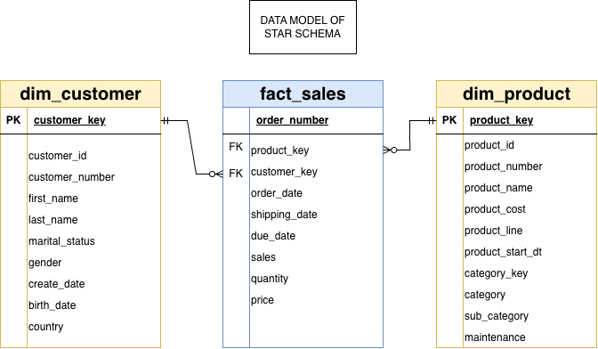

# SQL Data Warehouse Project

A modern **data warehouse built in SQL (MySQL)** using the **Medallion Architecture** — Bronze, Silver, and Gold layers. The project ingests raw CSV data from two source systems (CRM and ERP), cleans and standardizes it through an ETL pipeline, and exposes a business-ready **star schema** for BI, reporting, and analytics.

---

## 📐 Architecture

The warehouse follows the three-layer medallion pattern. Data flows left to right — from raw source files, through progressive refinement, to analytics consumers.


| Layer | Object Type | Load Strategy | Transformations | Data Model |
|-------|-------------|---------------|-----------------|------------|
| **Bronze** | Tables | Batch · Full load · Truncate & Insert | None — raw, *as-is* | None |
| **Silver** | Tables | Batch · Full load · Delete & Insert | Cleaning, standardization, normalization, derived columns, enrichment | None |
| **Gold** | Views | No load (views on Silver) | Data integration, aggregation, business logic | **Star schema** |

- **Sources:** CRM and ERP, delivered as CSV files in folders.
- **Consumers:** BI & reporting tools (e.g. Power BI), SQL ad-hoc analysis, and AI/ML workloads.

---

## 🗂️ Repository Structure

```
SQL_DataWarehouse_Project/
│
├── datasets/                        # Raw source data (CSV)
│   ├── source_crm/
│   │   ├── cust_info.csv             # Customer master (~18.5k rows)
│   │   ├── prd_info.csv              # Product master (~397 rows)
│   │   └── sales_details.csv         # Sales transactions (~60k rows)
│   └── source_erp/
│       ├── CUST_AZ12.csv             # ERP customer demographics (birthdate, gender)
│       ├── LOC_A101.csv              # ERP customer location / country
│       └── PX_CAT_G1V2.csv           # Product category / subcategory lookup
│
├── scripts/
│   ├── sql_database_setup            # Creates the database + bronze/silver/gold schemas
│   ├── bronzelayer/
│   │   ├── bronzelayer_ddl.sql       # DDL: bronze tables
│   │   └── bronzelayer_dataloading.sql   # BULK load CSVs into bronze
│   ├── silverlayer/
│   │   ├── silverlayer_ddl.sql       # DDL: silver tables (+ dwh_create_date)
│   │   └── silverlayer_dataloading.sql   # Stored proc: ETL bronze → silver
│   └── goldlayer/
│       └── goldlayer_creatingviews.sql   # Gold views: dim_customer, dim_product, fact_sales
│
├── tests/
│   ├── silverlayer_datachecking_cleaning.sql   # Quality checks for the silver layer
│   └── goldlayer_querytesting.sql              # Integrity & relationship checks for gold
│
├── docs/                            # Architecture & data-model diagrams (.drawio + .png)
│   ├── Project Datawarehouse Architecture.png
│   ├── data_flow_diagram.png
│   ├── data_integration.png
│   └── data_model_goldlayer.png
│
├── LICENSE                          # MIT
└── README.md
```

---

## 🔄 The Data Pipeline

### 1. Bronze Layer — Raw Ingestion
Loads the six source CSVs *as-is* into bronze tables. Each table is truncated and reloaded via MySQL `LOAD DATA LOCAL INFILE` (bulk insert), with per-table and total load timings. No transformation is applied — the bronze layer is a faithful copy of the source.

### 2. Silver Layer — Clean & Standardize
A stored procedure, `silver.load_silver()`, runs the ETL from bronze to silver inside a transaction (with an error handler that rolls back on failure). Key transformations include:

- **Customers (`crm_cust_info`):** deduplicate by latest `cst_create_date`, trim names, decode marital status (`M`/`S` → Married/Single) and gender (`M`/`F` → Male/Female).
- **Products (`crm_prd_info`):** split `prd_key` into a `cat_key` (joins to ERP category) and product key, map `prd_line` codes to labels (Road, Mountain, Touring, Other Sales), and derive `prd_end_dt` from the next product's start date (`LEAD`).
- **Sales (`crm_sales_details`):** convert integer `YYYYMMDD` dates to proper `DATE`, and recompute invalid/missing `sales` and `price` (`sales = quantity × ABS(price)`).
- **ERP demographics (`erp_cust_az12`):** strip `NAS` prefix from IDs, null out future birthdates, normalize gender.
- **ERP location (`erp_loc_a101`):** normalize country codes (`US`/`USA` → United States, `DE` → Germany).

Every silver table carries a `dwh_create_date` metadata column.

### 3. Gold Layer — Business-Ready Star Schema
Three views model the data for consumption:



- **`gold.dim_customer`** — one row per customer, enriched from CRM + ERP, with a surrogate `customer_key`. Gender falls back from CRM to ERP when missing.
- **`gold.dim_product`** — current products only (`prd_end_dt IS NULL`), with a surrogate `product_key` and category/subcategory from ERP.
- **`gold.fact_sales`** — sales transactions joined to the two dimensions via their surrogate keys.

---

## 🚀 Getting Started

### Prerequisites
- **MySQL 8.0+** (the scripts use window functions, CTEs, stored procedures, and `LOAD DATA LOCAL INFILE`).
- MySQL Workbench or any MySQL client.

### Setup

1. **Create the database and schemas**
   ```sql
   -- scripts/sql_database_setup
   ```
   > ⚠️ This drops and recreates the databases — all existing data is permanently deleted. Run with caution.

2. **Enable local file loading** (required for the bulk load)
   - Server side: `SET GLOBAL local_infile = 1;`
   - Client side (Workbench): connection → **Advanced** tab → **Others** box → add `OPT_LOCAL_INFILE=1`, then reconnect.

3. **Build & load Bronze**
   ```sql
   source scripts/bronzelayer/bronzelayer_ddl.sql;
   source scripts/bronzelayer/bronzelayer_dataloading.sql;
   ```
   > 📌 Update the `LOAD DATA LOCAL INFILE '...'` file paths in `bronzelayer_dataloading.sql` to point to this repo's `datasets/` folder on your machine (they currently use absolute paths from the author's environment).

4. **Build Silver & run the ETL**
   ```sql
   source scripts/silverlayer/silverlayer_ddl.sql;
   source scripts/silverlayer/silverlayer_dataloading.sql;  -- creates the procedure
   CALL silver.load_silver();                                -- runs the ETL
   ```

5. **Create the Gold views**
   ```sql
   source scripts/goldlayer/goldlayer_creatingviews.sql;
   ```

6. **(Optional) Run quality checks**
   ```sql
   source tests/silverlayer_datachecking_cleaning.sql;
   source tests/goldlayer_querytesting.sql;
   ```

Once complete, query the gold views directly — for example:
```sql
SELECT * FROM gold.fact_sales;
SELECT * FROM gold.dim_customer;
SELECT * FROM gold.dim_product;
```

---

## 🧪 Data Quality Checks

The `tests/` scripts validate the warehouse after loading:

- **Silver:** null/duplicate primary keys, unwanted whitespace, value standardization, consistency across related fields, and invalid date ranges.
- **Gold:** uniqueness of surrogate keys, referential integrity between facts and dimensions, and validation of the data-model relationships.

---

## 📏 Naming Conventions

- **snake_case** for all objects; English only; no SQL reserved words.
- **Bronze / Silver:** `<sourcesystem>_<entity>` (e.g. `crm_cust_info`, `erp_loc_a101`) — names match the source.
- **Gold:** `<category>_<entity>` with a business-aligned name (e.g. `dim_customer`, `fact_sales`).
- **Surrogate keys:** `<entity>_key` (e.g. `customer_key`).
- **Technical columns:** `dwh_<name>` (e.g. `dwh_create_date`).
- **Load procedures:** `load_<layer>` (e.g. `load_silver`).

See `docs/Define Project Naming Conventions ...md` for the full specification.

---

## 🛠️ Tech Stack

- **Database:** MySQL
- **Language:** SQL (DDL, DML, stored procedures, window functions)
- **Architecture:** Medallion (Bronze / Silver / Gold)
- **Modeling:** Star schema (fact + dimension views)
- **Diagrams:** draw.io

---

## 📄 License

Released under the **MIT License**. See [LICENSE](LICENSE).

**Author:** Darshil Parikh
